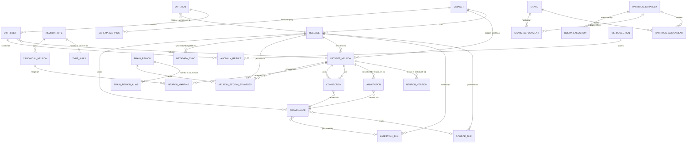

# Architecture

The current interactive/API workflow is documented in [PROJECT_GUIDE.md](PROJECT_GUIDE.md).
Migration `0011` adds durable jobs, independent MongoDB record digests, model
features/explanations, correspondence score evidence, and versioned shard
deployments. `backend/workspace.py` provides release-aware graph/event reads;
`backend/analysis.py` provides anomaly and correspondence scoring;
`backend/jobs.py` runs two local workers with PostgreSQL-backed status.

```
public releases (hemibrain v1.0/1.1/1.2, FlyWire 630/783)
   │  scripts/download_datasets.py   (immutable raw files + SHA-256 manifest)
   ▼
source adapters  ── schema mapping registry (config/schema_mappings/*.yaml → cc.schema_mapping)
   │  bulk COPY into TEMP staging tables
   ▼
validation in SQL (ids, duplicates, orphan edges, conflicting annotations)
   ▼
bitemporal merge into PostgreSQL (one transaction per release)
   ▼
cc schema: provenance · dataset_neuron · neuron_version · annotation · connection
   ├── temporal query functions (neuron_at_release, connections_at_release, neuron_as_of, …)
   ├── ConnectomeDiff (run_temporal_diff → diff_run / diff_event)
   ├── entity resolution (canonical_neuron / neuron_mapping / type crosswalk)
   ├── brain regions (brain_region, brain_region_alias, neuron_region_synapses)
   ├── er schema: the team ER diagram as views (er.connection, er.annotation, …)
   └── partition_assignment (hash | anatomical | community)
          │  binary COPY, verified per shard
          ▼
       3 shard instances (schemas p_hash, p_anatomical, p_community) ◄── query router (Python)
MongoDB connectome_meta.neuron_source_record: original source rows per neuron and
   release, _id = dataset_neuron.metadata_doc_id, checked by `metadata check`
ML (next): Isolation Forest over diff_event features; embedding matcher proposals
```

## ER model

The eight synopsis entities are the core; supporting tables are added where a
requirement needs them.



| synopsis entity | table(s) | notes |
|---|---|---|
| DATASET | `dataset` | |
| RELEASE | `release` | `release_order` is the valid-time axis; `release_date` NULL unless officially confirmed |
| DATASET_NEURON | `dataset_neuron` + `neuron_version` | identity per (dataset, original id) as text; existence per release range is versioned. *Deviation:* the synopsis ties a dataset neuron to one release; we keep one identity across releases and version its existence, so an unchanged neuron is not duplicated per release |
| CANONICAL_NEURON | `canonical_neuron` | internal identity, never replaces source ids |
| NEURON_MAPPING | `neuron_mapping` | method, confidence, evidence, review status; NULL target = unresolved |
| CONNECTION | `connection` | endpoints are dataset neurons of the same dataset (composite FK) |
| ANNOTATION | `annotation` | key/value, versioned |
| PROVENANCE | `provenance` (+ `source_file`, `ingestion_run`, `provenance_parent`) | facts carry `provenance_id` + source line(s) |

## Team ER diagram → database

The team's ER diagram (DATASET, RELEASE, DATASET_NEURON, CANONICAL_NEURON,
NEURON_MAPPING, CONNECTION, ANNOTATION, PROVENANCE) is available attribute
for attribute as views in schema `er` (`backend/db/sql/0007_er_views.sql`):

| diagram entity / relationship | view | how its attributes are produced |
|---|---|---|
| DATASET (data_formats multivalued, release_count derived) | `er.dataset` | `dataset` columns; `release_count` counted |
| RELEASE (neuron_count, connection_count derived) | `er.release` | `version_tag` = `version_label`, `checksum` = manifest SHA-256; counts from `release_overview` |
| DATASET_NEURON, DEFINES | `er.dataset_neuron` | `release_id` = release that introduced it; `original_name/type` = latest annotations; `original_region` = primary brain region; `raw_metadata` = MongoDB document id; `alternate_ids` = other source ids of the same canonical neuron |
| CANONICAL_NEURON (neuron_classification composite, alternative_names multivalued) | `er.canonical_neuron` | `cell_type`, `cell_class`, `brain_region` from its source neuron(s); `alternative_names` = all mapped source ids |
| NEURON_MAPPING, MAPPED_BY, REFERENCED_BY | `er.neuron_mapping` | plus `review_status`, without which a proposal could be read as a match |
| CONNECTION, SENDS / RECEIVES, CONTAINS | `er.connection` | `from/to_neuron_id` are **canonical** neurons via the approved mapping; `valid_from/valid_to` are releases, `transaction_from/to` timestamps; `weight` = `synapse_count` (both sources publish synapse counts) |
| ANNOTATION, HAS_ANNOTATION, PROVIDES | `er.annotation` | on the canonical neuron; `source` = file and line |
| PROVENANCE, SOURCED_FROM | `er.provenance`, `er.record_provenance(entity, id)` | one row per run × file × transformation; record id and row number per fact via the function |

Why the physical tables differ from the diagram (deliberately):
- **Connections and annotations reference source neurons, not canonical
  ones.** Source data only ever states facts about source neurons; tying them
  to canonical neurons would make an edge change when a mapping is reviewed.
  Every source neuron has exactly one approved canonical neuron (its own
  identity or a reviewed cross-dataset match), so the diagram's
  canonical-level view is exact.
- **One row per fact with valid/transaction intervals** instead of one row
  per release: unchanged facts are stored once (9.0M instead of 15.8M
  connection rows), and the diagram's `valid_from/valid_to/transaction_from/to`
  are the interval bounds.
- **Row numbers live on the facts**, not in one provenance row per record
  (which would be ~9M provenance rows).
- **raw_metadata** is a MongoDB document, not a column: its shape differs by
  source and release.

## MongoDB source records

One document per source neuron in `connectome_meta.neuron_source_record`,
`_id` = `dataset_neuron.metadata_doc_id` (e.g. `flywire:720575940596125868`).
For each synced release it holds every original row about the neuron from
every mapped neuron file, with **all** columns (also those the relational
model does not map, such as FlyWire's per-transmitter prediction scores), the
file, line, SHA-256 and `source_file_id`. A release is synced only after it is
loaded in PostgreSQL and only from files whose checksum still matches;
re-syncing replaces that release's entry. Each sync is recorded in
`cc.metadata_sync`. Because no foreign key can span two stores,
`metadata check` verifies the references both ways.

## Distributed storage

Three PostgreSQL shard containers emulate a distributed deployment on one
machine. A neuron is owned by one shard; a connection row is stored on the
owner of its pre-synaptic neuron and mirrored on the owner of its
post-synaptic neuron when they differ. 1-hop queries therefore always hit one
shard, and the mirrored fraction (the edge cut) is what strategies compete on.

| strategy | owner of a neuron |
|---|---|
| hash | `hashint8(dataset_neuron_id) mod 3` |
| anatomical | its primary brain region; regions packed onto shards by edge load (LPT) |
| community | its Louvain community in the latest release graph (igraph); communities packed by edge load |

Each strategy is deployed to its own schema on every shard (`p_hash`,
`p_anatomical`, `p_community`) with replicated `release` and `neuron` tables,
streamed with binary COPY and verified against the coordinator (row counts,
sums of ids and synapse counts per shard) before it is recorded in
`cc.shard_deployment`. Shards hold the current belief (open transaction time)
with full valid-time history; transaction-time audit stays on the
coordinator. The router (`backend/distributed/router.py`) sends a query only
to shards that can hold an answer, runs multi-shard steps in parallel, merges
results and logs each execution in `cc.query_execution`.

## Integrity

- PK / FK everywhere; composite FKs `(release_id, dataset_id)` and
  `(dataset_neuron_id, dataset_id)` make cross-dataset edges and
  release/dataset mismatches impossible.
- CHECKs: non-negative synapse counts, confidence ∈ [0,1], status enums,
  non-empty intervals, `unresolved ⇔ canonical_neuron_id IS NULL`,
  temporal diff only within one dataset.
- **Exclusion constraints** (GiST, `btree_gist`): no two versions of the same
  fact may overlap in both valid time and transaction time.
- Partial unique index: at most one *approved* mapping per source neuron.
- **Trigger `guard_history`**: versioned rows can only have their
  transaction-time interval closed; UPDATE of anything else and DELETE are rejected.

## Temporal design

Each versioned row has `valid_rel int4range` (release orders in which the fact
holds; open upper bound = still holds in the newest release) and
`tx tstzrange` (when the database believed it; open upper bound = current).
Loading release N:

1. open rows whose fact is not restated identically in N are *retired*:
   `tx` is closed at the load transaction's `now()` and a copy valid only up
   to N is inserted (bitemporal correction, nothing overwritten);
2. facts of N without an identical open row are inserted valid from N.

Unchanged facts keep one row across releases (delta storage). Queries:
*release-specific* (`valid_rel @> order`), *as-of* (`tx @> timestamp`), or
both. Loading an old release later does not pretend the database knew it
earlier: its rows' `tx` starts at the load time. Releases must be loaded in
order per dataset (enforced); out-of-order backfill is a known limitation.

## Transactions

`ingest` uses three transactions: register (commit) → load everything for the
release (commit or full rollback) → on failure record the error (commit).
Concurrent loads of one dataset are serialized with `SELECT … FOR UPDATE` on
the dataset row.

## ConnectomeDiff

`run_temporal_diff(release_a, release_b, as_of)` performs three set-based
FULL OUTER JOINs (neurons, annotations per key, connections per pair) over
the two release states as believed at `as_of`, persists events, and returns
the same run for identical inputs. Cross-dataset comparison is a separate
mode and is rejected by a CHECK constraint in temporal mode.
