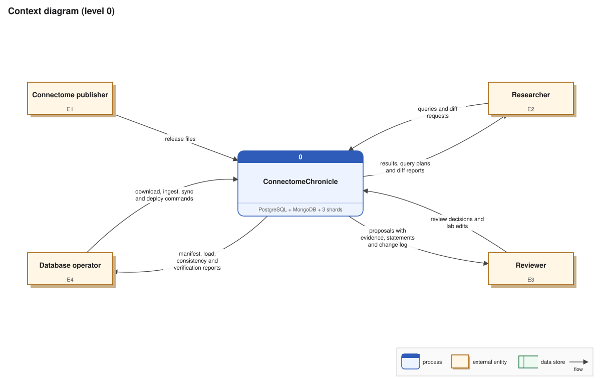
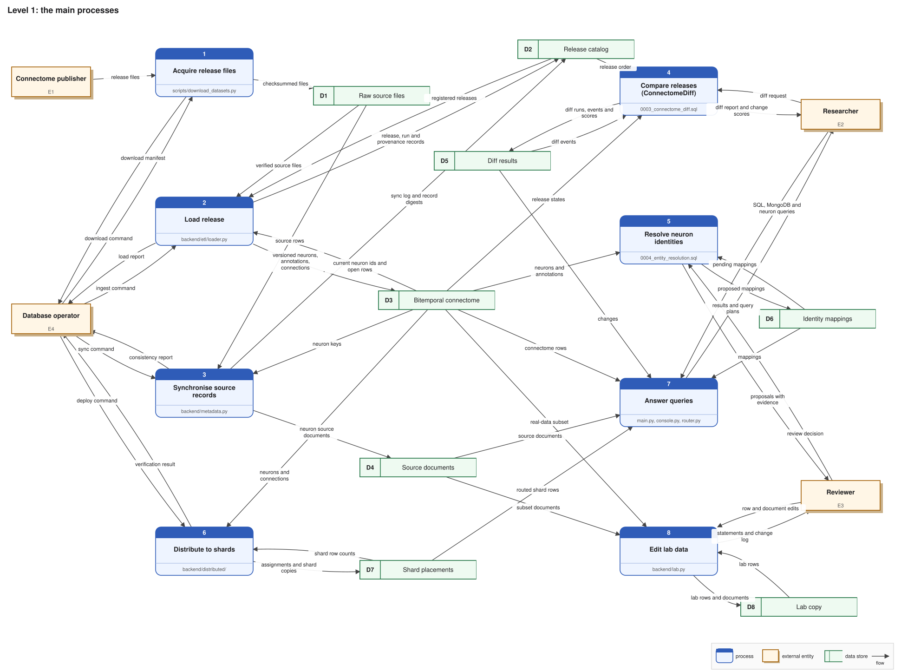
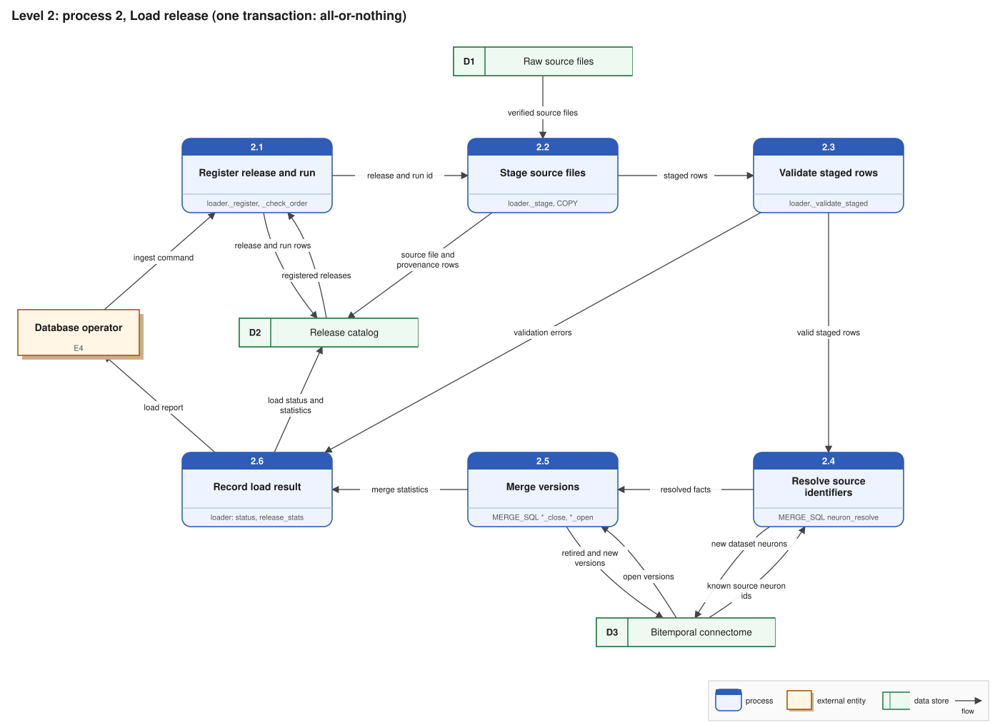
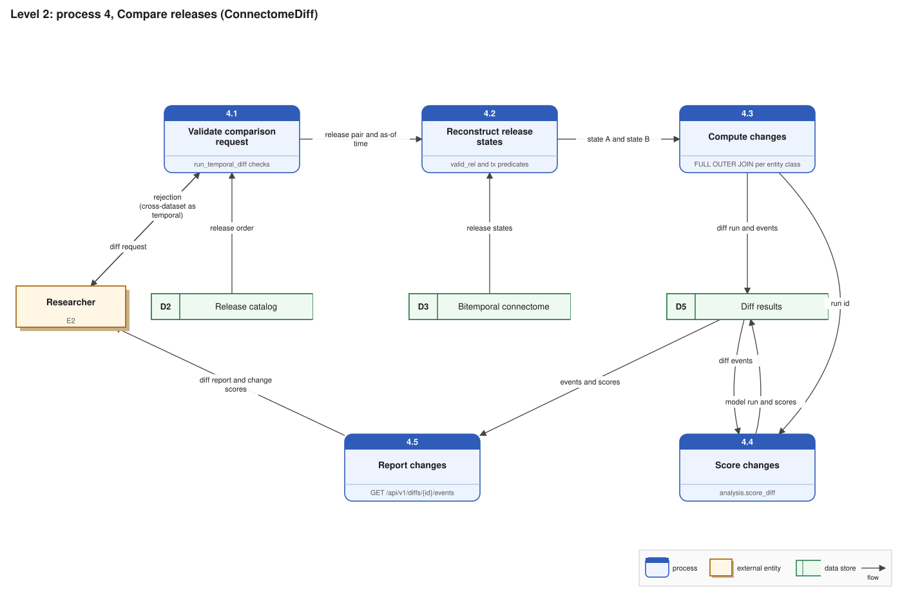

# Data flow

How data enters ConnectomeChronicle, which processes transform it, where it
is stored, and what leaves the system, drawn as data flow diagrams (DFDs)
at three levels:

- **Level 0, the context diagram:** the whole system as one process, with
  the people and organisations it exchanges data with.
- **Level 1:** the eight main processes and the eight data stores.
- **Level 2:** two processes broken down further:
  - process 2, *Load release*, where the bitemporal store is written;
  - process 4, *Compare releases*, where ConnectomeDiff runs.

The diagrams are generated from one description,
[`config/dfd.yaml`](../config/dfd.yaml), by
[`backend/design/dfd.py`](../backend/design/dfd.py). The same module checks
the DFD rules listed below before anything is drawn, so a diagram cannot show
a flow that breaks them. `python scripts/design_docs.py dfd` regenerates the
SVGs and the tables in this document. The dashboard's **Design → Data flow**
page shows the same diagrams with each flow listed.

## Notation (Gane–Sarson)

| Symbol | Meaning | In these diagrams |
|---|---|---|
| Rounded box with a number band | **Process**: transforms incoming data into outgoing data | Numbered hierarchically: `0` (whole system), `1`…`8`, then `2.1`…`2.6` inside process 2. Named verb + object. The bottom band names the code that implements it. |
| Open-ended box with a `D` number | **Data store**: data at rest | `D1`…`D8`. The table below lists the tables or collections each one holds. |
| Shaded box | **External entity**: a source or destination outside the system | `E1`…`E4` |
| Labelled arrow | **Data flow**: data in motion | The label names the data, not an action. A flow on a lower level that is one part of a higher-level flow is linked to it (`part_of`). |

## Rules checked

The checker applies these rules to every diagram:
- **Data moves only through processes.** A flow cannot go directly from an
  external entity to another entity or to a store, or from one store to
  another.
- **Every process has input and output.** A process with input but no output
  is a *black hole*; a process with output but no input is a *miracle*.
- **Every store is used both ways.** Each data store is written somewhere and
  read somewhere.
- **Child diagrams are balanced.** The flows that cross a child diagram's
  boundary are exactly the flows of its parent process. They carry the same
  external entities and stores, in the same direction, with the same data or
  a named part of it. A data store that first appears on a child diagram is
  local to that process.

<!-- generated:check -->
All rules hold (2026-11-23 13:04 UTC).

| Rule | Checked | Result |
|---|---|---|
| R1 | every flow has a label and connects elements of its diagram | ✓ |
| R2 | data moves only through a process: no external→external, external↔store or store→store flow | ✓ |
| R3 | every process has at least one input and one output (no black hole, no miracle) | ✓ |
| R4 | process numbers are hierarchical: a child of process n is numbered n.1, n.2, ... | ✓ |
| R5 | process names start with a verb (verb + object); the context process names the system | ✓ |
| R6 | a child diagram is balanced: its flows across the boundary are exactly the parent process's flows (data stores first shown on the child are local to the process) | ✓ |
| R7 | the context diagram has one process (0) and no data stores | ✓ |
| R8 | every data store is both written and read in the model | ✓ |
| R9 | no flow is drawn twice (same source, target and label) | ✓ |

| Diagram | Processes | External entities | Data stores | Flows |
|---|---|---|---|---|
| level0 | 1 | 4 | 0 | 7 |
| level1 | 8 | 4 | 8 | 46 |
| level2-2 | 6 | 1 | 3 | 17 |
| level2-4 | 5 | 1 | 3 | 12 |
<!-- /generated:check -->

## Elements

<!-- generated:elements -->
**External entities**

| Id | Name | Role |
|---|---|---|
| E1 | Connectome publisher | Janelia (hemibrain) and the FlyWire consortium; publish release files |
| E2 | Researcher | explores neurons, runs SQL / MongoDB queries and ConnectomeDiff |
| E3 | Reviewer | reviews identity mappings and edits the lab copy (review token) |
| E4 | Database operator | downloads, loads, synchronises and deploys releases (CLI) |

**Data stores** (what each holds in the implementation)

| Id | Name | Holds |
|---|---|---|
| D1 | Raw source files | data/raw/ archives + data/metadata/dataset_manifest.json (SHA-256) |
| D2 | Release catalog | dataset, release, ingestion_run, source_file, provenance, provenance_parent, schema_mapping, metadata_sync, metadata_record_digest |
| D3 | Bitemporal connectome | dataset_neuron, neuron_version, annotation, connection, neuron_region_synapses, brain_region, neuropil, brain_region_alias, neuron_type, type_alias |
| D4 | Source documents | MongoDB neuron_source_record (one document per neuron, every original row) |
| D5 | Diff results | diff_run, diff_event, ml_model_run, ml_model_input, anomaly_result |
| D6 | Identity mappings | canonical_neuron, neuron_mapping |
| D7 | Shard placements | partition_strategy, partition_assignment, shard, deployment_batch, active_deployment, shard_deployment, query_execution + the shard servers' copies |
| D8 | Lab copy | schema lab (dataset, release, neuron, connection, change_log) + MongoDB <db>_lab |
<!-- /generated:elements -->

## Level 0: context diagram

The system exchanges data with four external entities:
- **E1 Connectome publisher** (Janelia, FlyWire) provides release files.
- **E4 Database operator** loads, synchronises and deploys them.
- **E2 Researcher** asks questions and compares releases.
- **E3 Reviewer** decides on identity mappings and edits the lab copy.

<!-- generated:level0 -->

| No. | Process | Implemented by |
|---|---|---|
| 0 | ConnectomeChronicle | PostgreSQL + MongoDB + 3 shards |

7 flows

| From | To | Data | Part of (parent flow) |
|---|---|---|---|
| E1 | 0 | release files |  |
| E4 | 0 | download, ingest, sync and deploy commands |  |
| 0 | E4 | manifest, load, consistency and verification reports |  |
| E2 | 0 | queries and diff requests |  |
| 0 | E2 | results, query plans and diff reports |  |
| E3 | 0 | review decisions and lab edits |  |
| 0 | E3 | proposals with evidence, statements and change log |  |

<!-- /generated:level0 -->

## Level 1: main processes

Read it left to right. The operator's processes **1 → 2 → 3 → 6** bring a
release in and spread it out:
- 1 downloads and checksums the files;
- 2 loads them as bitemporal facts;
- 3 stores every original row as a MongoDB document;
- 6 places the neurons on three shards.

The researcher's and reviewer's processes **4, 5, 7, 8** read what was
loaded:
- 4 compares two releases;
- 5 proposes cross-dataset identities for review;
- 7 answers queries from every store, including routed shard queries;
- 8 lets the reviewer change an isolated copy.

**D3 Bitemporal connectome** is the centre of the system. Only process 2
writes it, and every other process reads it.

<!-- generated:level1 -->

| No. | Process | Implemented by |
|---|---|---|
| 1 | Acquire release files | scripts/download_datasets.py |
| 2 | Load release | backend/etl/loader.py |
| 3 | Synchronise source records | backend/metadata.py |
| 6 | Distribute to shards | backend/distributed/ |
| 4 | Compare releases (ConnectomeDiff) | 0003_connectome_diff.sql |
| 5 | Resolve neuron identities | 0004_entity_resolution.sql |
| 7 | Answer queries | main.py, console.py, router.py |
| 8 | Edit lab data | backend/lab.py |

46 flows

| From | To | Data | Part of (parent flow) |
|---|---|---|---|
| E1 | 1 | release files | release files |
| E4 | 1 | download command | download, ingest, sync and deploy commands |
| 1 | E4 | download manifest | manifest, load, consistency and verification reports |
| 1 | D1 | checksummed files |  |
| D1 | 2 | verified source files |  |
| E4 | 2 | ingest command | download, ingest, sync and deploy commands |
| 2 | E4 | load report | manifest, load, consistency and verification reports |
| D2 | 2 | registered releases |  |
| 2 | D2 | release, run and provenance records |  |
| D3 | 2 | current neuron ids and open rows |  |
| 2 | D3 | versioned neurons, annotations, connections |  |
| D1 | 3 | source rows |  |
| D3 | 3 | neuron keys |  |
| 3 | D4 | neuron source documents |  |
| 3 | D2 | sync log and record digests |  |
| E4 | 3 | sync command | download, ingest, sync and deploy commands |
| 3 | E4 | consistency report | manifest, load, consistency and verification reports |
| E4 | 6 | deploy command | download, ingest, sync and deploy commands |
| 6 | E4 | verification result | manifest, load, consistency and verification reports |
| D3 | 6 | neurons and connections |  |
| 6 | D7 | assignments and shard copies |  |
| D7 | 6 | shard row counts |  |
| E2 | 4 | diff request | queries and diff requests |
| 4 | E2 | diff report and change scores | results, query plans and diff reports |
| D2 | 4 | release order |  |
| D3 | 4 | release states |  |
| 4 | D5 | diff runs, events and scores |  |
| D5 | 4 | diff events |  |
| D3 | 5 | neurons and annotations |  |
| 5 | D6 | proposed mappings |  |
| D6 | 5 | pending mappings |  |
| 5 | E3 | proposals with evidence | proposals with evidence, statements and change log |
| E3 | 5 | review decision | review decisions and lab edits |
| E2 | 7 | SQL, MongoDB and neuron queries | queries and diff requests |
| 7 | E2 | results and query plans | results, query plans and diff reports |
| D3 | 7 | connectome rows |  |
| D4 | 7 | source documents |  |
| D5 | 7 | changes |  |
| D6 | 7 | mappings |  |
| D7 | 7 | routed shard rows |  |
| E3 | 8 | row and document edits | review decisions and lab edits |
| 8 | E3 | statements and change log | proposals with evidence, statements and change log |
| D3 | 8 | real-data subset |  |
| D4 | 8 | subset documents |  |
| 8 | D8 | lab rows and documents |  |
| D8 | 8 | lab rows |  |

<!-- /generated:level1 -->

Processes 4, 5 and 6 can also run as background jobs (`workspace_job`, via
`POST /api/v1/workspace/jobs`). The job queue controls *when* they run and does not
change *what* data flows, so it is not drawn as a data store.

## Level 2: process 2, Load release

One release is loaded in one database transaction. If any step fails,
nothing of the release is kept, and only the failure is recorded (in a
separate transaction). Steps 2.4 and 2.5 implement the merge rule that keeps
storage proportional to change: an unchanged fact keeps its row, and a
changed fact's row is retired (its `tx` interval is closed) before the new
version is inserted.

<!-- generated:level2-2 -->

| No. | Process | Implemented by |
|---|---|---|
| 2.1 | Register release and run | loader._register, _check_order |
| 2.2 | Stage source files | loader._stage, COPY |
| 2.3 | Validate staged rows | loader._validate_staged |
| 2.4 | Resolve source identifiers | MERGE_SQL neuron_resolve |
| 2.5 | Merge versions | MERGE_SQL *_close, *_open |
| 2.6 | Record load result | loader: status, release_stats |

17 flows

| From | To | Data | Part of (parent flow) |
|---|---|---|---|
| E4 | 2.1 | ingest command |  |
| D2 | 2.1 | registered releases |  |
| 2.1 | D2 | release and run rows | release, run and provenance records |
| 2.1 | 2.2 | release and run id |  |
| D1 | 2.2 | verified source files |  |
| 2.2 | D2 | source file and provenance rows | release, run and provenance records |
| 2.2 | 2.3 | staged rows |  |
| 2.3 | 2.4 | valid staged rows |  |
| 2.3 | 2.6 | validation errors |  |
| D3 | 2.4 | known source neuron ids | current neuron ids and open rows |
| 2.4 | D3 | new dataset neurons | versioned neurons, annotations, connections |
| 2.4 | 2.5 | resolved facts |  |
| D3 | 2.5 | open versions | current neuron ids and open rows |
| 2.5 | D3 | retired and new versions | versioned neurons, annotations, connections |
| 2.5 | 2.6 | merge statistics |  |
| 2.6 | D2 | load status and statistics | release, run and provenance records |
| 2.6 | E4 | load report |  |

<!-- /generated:level2-2 -->

## Level 2: process 4, Compare releases (ConnectomeDiff)

Step 4.1 rejects a comparison that would mix datasets under the *temporal*
mode. Cross-dataset comparison is a separate mode and is never reported as
change over time. Step 4.2 reads both releases as the database believed them
at one transaction time, so a diff can be repeated exactly later. Step 4.3
is a set-based `FULL OUTER JOIN` per entity class, run in SQL.

<!-- generated:level2-4 -->

| No. | Process | Implemented by |
|---|---|---|
| 4.1 | Validate comparison request | run_temporal_diff checks |
| 4.2 | Reconstruct release states | valid_rel and tx predicates |
| 4.3 | Compute changes | FULL OUTER JOIN per entity class |
| 4.4 | Score changes | analysis.score_diff |
| 4.5 | Report changes | GET /api/v1/diffs/{id}/events |

12 flows

| From | To | Data | Part of (parent flow) |
|---|---|---|---|
| E2 | 4.1 | diff request |  |
| D2 | 4.1 | release order |  |
| 4.1 | E2 | rejection (cross-dataset as temporal) | diff report and change scores |
| 4.1 | 4.2 | release pair and as-of time |  |
| D3 | 4.2 | release states |  |
| 4.2 | 4.3 | state A and state B |  |
| 4.3 | D5 | diff run and events | diff runs, events and scores |
| D5 | 4.4 | diff events |  |
| 4.4 | D5 | model run and scores | diff runs, events and scores |
| 4.3 | 4.4 | run id |  |
| D5 | 4.5 | events and scores | diff events |
| 4.5 | E2 | diff report and change scores |  |

<!-- /generated:level2-4 -->
